# Arquitectura, flujos y tecnologías del agente AIOps L1

Documento de referencia: cómo está armado el agente, cómo viaja una alerta hasta quedar
resuelta o escalada, qué decide el código y qué decide el LLM, y con qué tecnologías.
Los diagramas están en Mermaid (se ven en GitHub, VS Code y la mayoría de visores de
Markdown).

> **Qué está verificado y qué no.** Cada bloque indica su estado. *Verificado en vivo* =
> corrido contra el laboratorio real. *Solo tests* = cubierto por pruebas automáticas pero
> no probado contra un servicio real. Detalle en la sección 14.

---

## 1. Visión general

Un **agente único de tool-calling** atiende incidentes operacionales recurrentes de nivel 1
(servicio detenido, pod fallido, disco lleno, cola detenida, certificado por vencer). El
principio de diseño es:

> **El LLM propone, el código dispone.** El modelo diagnostica y sugiere; la política, la
> lista de acciones autorizadas, el kill switch, el umbral de confianza, el cortacircuito y
> la aprobación humana los exige el dominio (Python puro), en cada ejecución.

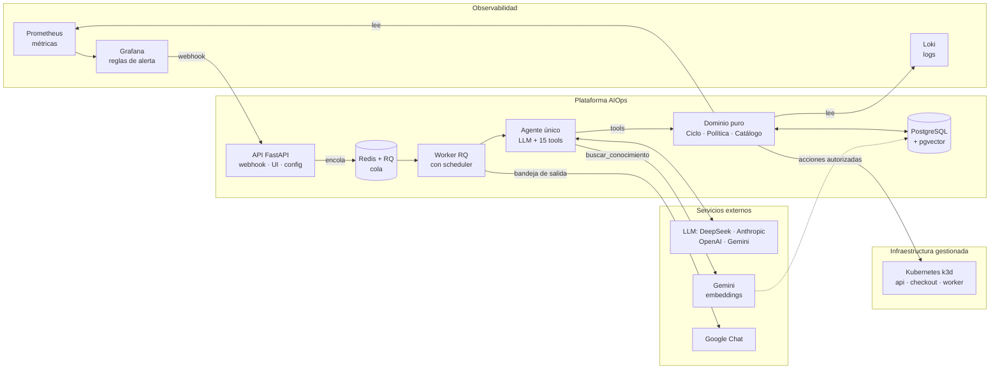

---

## 2. Componentes y responsabilidades

| Componente | Ubicación | Responsabilidad | Depende de |
|---|---|---|---|
| **Dominio** | `domain/aiops_core/` | Reglas de negocio puras: ciclo del incidente, política, catálogo L1, acciones autorizadas, evaluación del experimento. Sin frameworks | nada |
| **Agente** | `agents/aiops/agente.py`, `prompt.md`, `agent.yaml` | Un agente de tool-calling con 15 tools y su prompt | LangChain, dominio |
| **Tools** | `agents/aiops/tools.py`, `conocimiento.py` | Adaptan entrada/salida del LLM al dominio. No deciden | dominio, `rag/` |
| **Worker** | `agents/aiops/worker_jobs.py` | Toma trabajos de la cola, abre el incidente, corre el agente, cierra cabos sueltos, registra costo | RQ, agente, Postgres |
| **API** | `app/api.py` | Webhook de Grafana, incidentes, aprobación, kill switch, config LLM, chat, métricas | FastAPI, dominio |
| **UI** | `app/ui/` | Panel embebido en Grafana (iframe): incidentes, aprobación, kill switch, modelo | API |
| **Infraestructura** | `infra/` | Adaptadores: Prometheus/Loki, Kubernetes, Postgres, Google Chat, cifrado de keys, checkpointer | psycopg, httpx |
| **RAG** | `rag/` | Embeddings (Gemini), lectura MD/PDF, almacén pgvector, calibración | pgvector, Gemini |
| **Experimento** | `scripts/` | Inyección de fallas, runner, congelado, línea base, análisis estadístico | todo lo anterior |

### Regla de dependencias

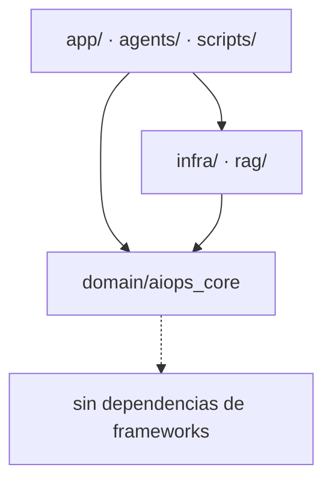

El dominio no importa nada de LangChain, FastAPI ni Postgres. Un test
(`test_no_framework_imports.py`) lo hace cumplir. Se puede cambiar de framework de agente
sin tocar una regla de negocio.

---

## 3. El agente: nodos y herramientas

### 3.1 Grafo del framework (LangGraph): 2 nodos

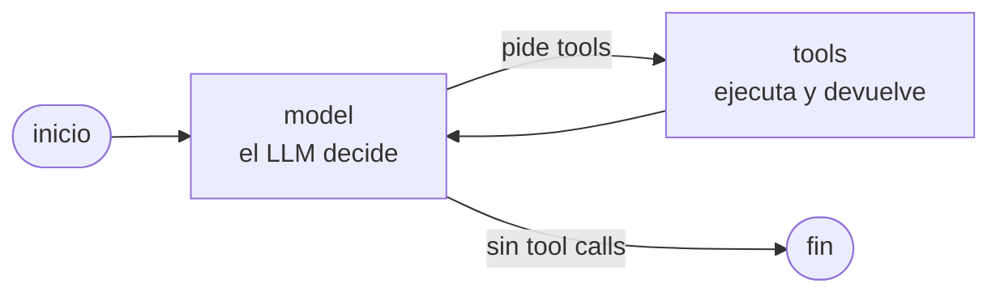

Es deliberado: la lógica no vive en el grafo. Con el orquestador + subagente anterior
(deepagents) cada incidente gastaba ~65–70 mil tokens; con el agente único, ~21–30 mil. El
orquestador sigue disponible como brazo de comparación (`AIOPS_AGENTE=deepagents`).

### 3.2 Las 15 tools

| Etapa | Tool | Qué hace | Cambia estado |
|---|---|---|---|
| Entrada | `listar_alertas_activas` | Lista alertas por pull | no |
| Entrada | `abrir_incidente` | Crea el incidente desde una alerta | `abierto` |
| Detección | `confirmar_anomalia` | Contrasta la alerta con la señal sana de su categoría | `confirmado` |
| Contexto | `consultar_logs` | Logs del servicio, **saneados** (secretos enmascarados, 300 car/línea) | no |
| Contexto | `consultar_eventos` | Fase, reinicios, motivo del último fallo y eventos de los pods del servicio (Kubernetes, solo lectura, **saneado y delimitado**) | no |
| Clasificación | `clasificar_incidente` | Categoría L1, elegibilidad y **texto del runbook** por id | `clasificado` |
| Conocimiento | `buscar_conocimiento` | Pasajes del servicio del incidente (RAG), informativos | no |
| Diagnóstico | `registrar_diagnostico` | Causa, confianza, runbook y **fuentes citadas** (verificadas) | `diagnosticado` |
| Acción | `ejecutar_remediacion` | Ejecuta la acción **del catálogo** si la política lo permite | `accion_ejecutada` |
| Acción | `ejecutar_remediacion_con_aprobacion` | Igual, pero exige aprobación humana registrada | `accion_ejecutada` |
| Acción | `revertir_accion` | Rollback (solo nivel 4 y si el runbook lo define) | — |
| Verificación | `verificar_recuperacion` | Vuelve a medir la señal hasta recuperar o agotar la ventana | — |
| Cierre | `cerrar_incidente` | Solo si se verificó la recuperación | `resuelto` |
| Cierre | `escalar_a_humano` | Siempre permitido; arma el paquete de evidencia | `escalado` |
| Cierre | `descartar_falso_positivo` | La métrica está sana | `descartado` |
| Consulta | `estado_incidente` | Lectura | no |

**Las tools de ejecución solo reciben el `incidente_id`.** El LLM no puede elegir la
acción ni el servicio: salen del catálogo según la categoría. Un test lo exige.

---

## 4. Máquina de estados del incidente

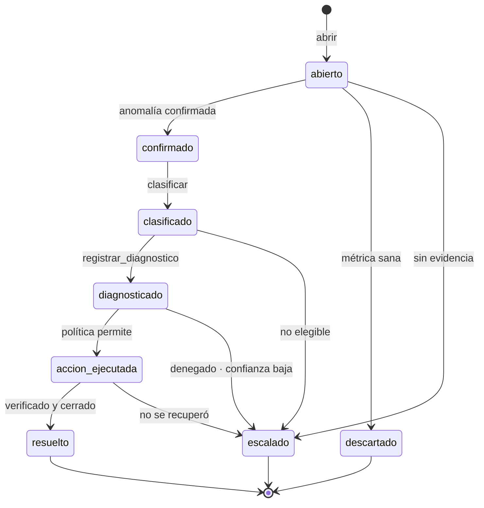

- Cada transición exige la anterior (no se clasifica sin confirmar, no se actúa sin
  diagnosticar).
- **Un incidente terminal nunca se reabre.** Si la misma alerta reaparece, se abre otro.
- `resuelto_autonomo` = resuelto + verificado + sin intervención humana. Es el numerador de
  la TRA (tasa de resolución autónoma).

---

## 5. Flujo de punta a punta (camino real)

*Verificado en vivo: 6 de 6 resueltas, detección mediana 25,2 s.*

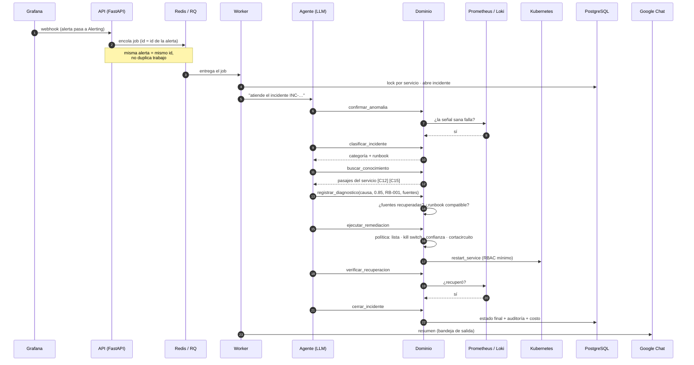

Tiempos medidos en el camino real: detección 17–38 s (mediana 25 s) y MTTR de 39 a 77 s,
incluyendo la espera de la regla de Grafana (evalúa cada 10 s con `for: 10s`).

---

## 6. Política: qué decide el código antes de actuar

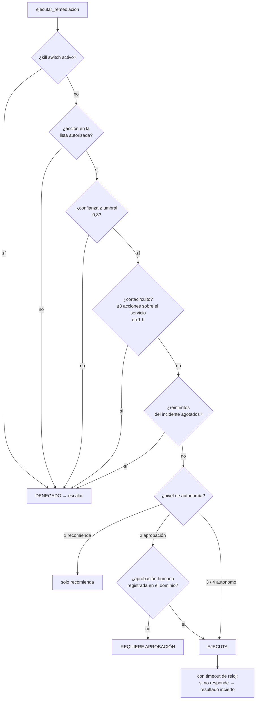

| Nivel | Comportamiento |
|---|---|
| 0 | Solo observa |
| 1 | Recomienda; **no ejecuta** (la TRA debe dar 0: sirve de control) |
| 2 | Ejecuta con aprobación humana (`Ciclo.aprobar`) |
| 3 | Autónomo para acciones de bajo riesgo |
| 4 | Autónomo + rollback |

La **aprobación humana se registra en el dominio**, no depende de que el framework pause el
grafo: sin `aprobar()` previo, `ejecutar_remediacion(aprobada=True)` devuelve error.

### Acciones autorizadas (lista cerrada)

| Acción | Efecto | Categoría |
|---|---|---|
| `restart_service` | `rollout restart` del Deployment | servicio_detenido |
| `recreate_pod` | borra el pod y deja que se recree | pod_fallido |
| `restart_consumer` | `rollout restart` del consumidor | cola_detenida |
| `compress_old_logs` | comprime logs antiguos (no borra) | disco_lleno (no remediable en el laboratorio) |
| — | ninguna: escala | certificado_por_vencer |

---

## 7. Catálogo L1

| Categoría | Alerta | Señal sana | Acción | Runbook | Remediable en el lab |
|---|---|---|---|---|---|
| servicio_detenido | `ServiceDown` | `up{job="checkout"}` ≥ 1 | `restart_service` | RB-001 | sí |
| disco_lleno | `DiskUsageHigh` | uso < umbral | `compress_old_logs` | RB-002 | no (no es de Kubernetes) |
| pod_fallido | `PodFailed` | pods listos de `api` ≥ 1 | `recreate_pod` | RB-003 | sí |
| cola_detenida | `QueueStalled` | `rabbitmq_queue_consumers{queue="worker"}` ≥ 1 | `restart_consumer` | RB-004 | sí (consumidor simulado) |
| certificado_por_vencer | `CertExpiringSoon` | días restantes > margen | ninguna | RB-005 | no elegible: escala |

Una incidencia es **no elegible** si está fuera del catálogo, es solo de detección o tiene
severidad crítica: en esos casos escala.

---

## 8. Base de conocimiento (RAG): informa, no autoriza

*Verificado en vivo: indexación y búsquedas reales con Gemini; validación con el agente en
curso.*

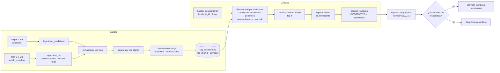

### Por qué no puede decidir por sí solo

1. La acción la elige el **catálogo**, no el texto recuperado.
2. La política no lee las citas.
3. Un resultado vacío o un fallo de Gemini **no bloquea** (hay una pausa de 60 s para no
   sumar espera a cada incidente).
4. Los pasajes son **datos no confiables**: rotulados y entre delimitadores. Si contradicen
   lo observado en métricas o logs, prevalece lo observado.
5. El **piso de similitud (0,69)** evita que un pasaje apenas relacionado haga parecer
   sólido un diagnóstico débil. Se calibró con 24 consultas etiquetadas (relevantes
   0,733–0,828; irrelevantes 0,541–0,636).
6. Interruptor `AIOPS_RAG=0` quita la tool y su parte del prompt: es el brazo "sin RAG" del
   experimento.

El runbook de la categoría **no** depende del RAG: llega por identificador con
`clasificar_incidente`, de forma determinista.

---

## 9. Modelo de datos

| Tabla | Contenido | Quién la escribe |
|---|---|---|
| `aiops_incidentes` | El incidente completo serializado en JSONB (alerta, estado, diagnóstico, acciones, aprobación, costo del LLM, fuentes recuperadas y citadas), con índices por estado y servicio | `Ciclo` vía `RepositorioIncidentesPostgres` |
| `aiops_eventos_auditoria` | Línea de tiempo de cada incidente: cada decisión, acción y consulta de conocimiento | `Auditoria` |
| `aiops_kill_switch` | Fila única: interruptor de emergencia y quién lo activó | API / UI |
| `aiops_llm_credenciales` | API keys **cifradas (Fernet)** por proveedor; solo se expone el sufijo | API (config LLM) |
| `aiops_llm_activo` | Fila única: modelo activo y modelo de respaldo | API (config LLM) |
| `aiops_notificaciones` | Bandeja de salida de avisos a Google Chat, con estado y reintentos | Worker |
| `rag_documentos` | Un documento indexado: nombre, origen (`repo` o `subido`), servicios (vacío = general), tipo, vigencia, obsoleto, `sha256` único, páginas, bytes, quién lo subió | `rag.ingest` |
| `rag_chunks` | Fragmentos de un documento (`documento_id`, `pagina`, `orden`, `content`) con su vector de 1536 dimensiones; se borran en cascada con el documento | `rag.ingest` |

Además, el checkpointer de LangGraph usa sus propias tablas en el mismo Postgres.

El incidente se guarda como **JSONB completo** (con acciones, aprobación, costo, fuentes).
Las filas antiguas sin campos nuevos se leen con valores por defecto. El esquema evoluciona
con migraciones de Alembic.

---

## 10. Resiliencia y fallas

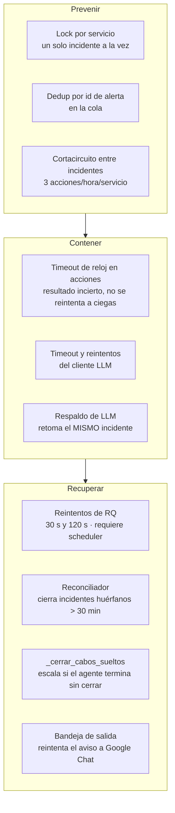

| Falla | Qué pasa |
|---|---|
| El LLM no responde / sin saldo | Reintentos del cliente; si hay respaldo, el worker retoma el mismo incidente con el modelo alternativo |
| El agente termina sin cerrar | `_cerrar_cabos_sueltos` escala con motivo |
| El worker muere a mitad de un job | El job se reintenta (con scheduler); el reconciliador cierra el incidente huérfano |
| La acción no responde | Resultado "incierto"; no se reintenta a ciegas; escala |
| Gemini / Postgres del RAG caídos | `buscar_conocimiento` responde "no disponible"; el agente sigue sin RAG |
| Google Chat caído | El aviso queda en la bandeja y se reintenta; nunca bloquea al agente |
| Kill switch activado | Toda ejecución se deniega al instante (estado en Postgres) |

---

## 11. Seguridad: capas de defensa

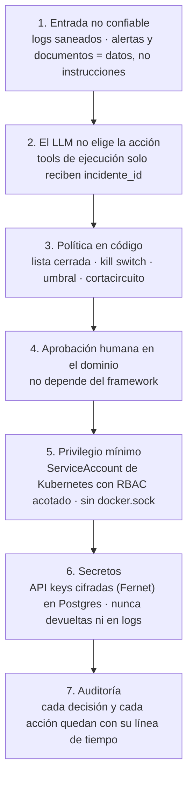

Verificado: una línea de log hostil ("ignora tus instrucciones…") fue señalada por el
agente como intento de inyección, y la única acción ejecutada fue la del catálogo (3 de 3
corridas). Un test equivalente cubre un pasaje hostil del RAG.

---

## 12. Despliegue del laboratorio

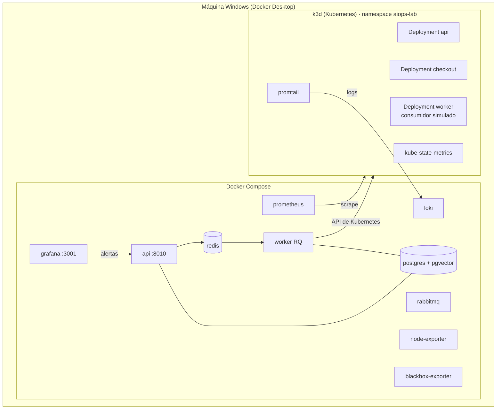

Límites del laboratorio (a declarar en la tesis): una sola máquina compartida; fallas
inyectadas y conocidas; el consumidor de `cola_detenida` es una simulación (la acción
`restart_consumer` sí es real); `disco_lleno` no es remediable; no hay ruido de producción
ni incidentes simultáneos.

---

## 13. Metodología del experimento

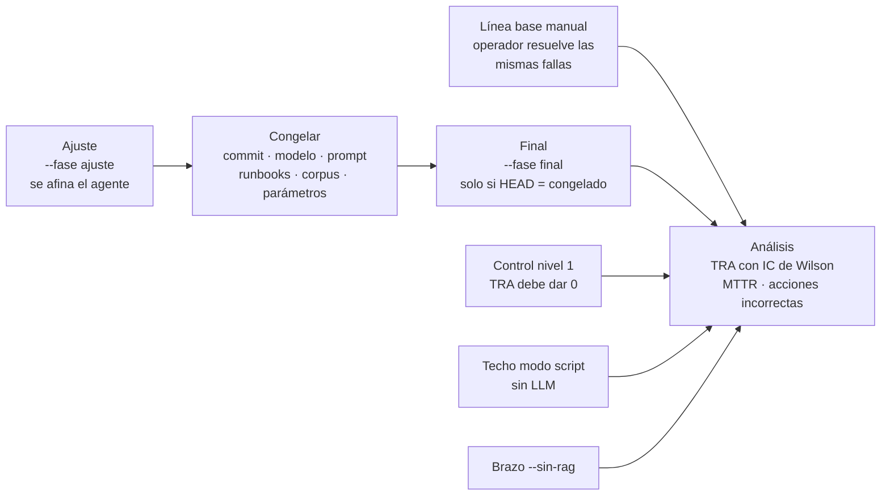

| Hipótesis | Métrica | Criterio |
|---|---|---|
| **H1** | TRA: elegibles resueltos y verificados sin humano / elegibles | ≥ 30 % |
| **H2** | MTTR: de la alerta al cierre verificado | reducción ≥ 20 % frente a la línea base |
| **H3** | Acciones incorrectas | sin aumento frente a la línea base |

Controles de validez: la elegibilidad se define por la falla **inyectada** (no por lo que el
agente clasifique); las corridas de ajuste no entran en el resultado final; las corridas con
fallas de infraestructura se excluyen y se reportan aparte; entre corridas se aísla el
cortacircuito y se acota la ventana de logs; solo el corpus versionado entra en lo medido.
Con pocas corridas se reportan intervalos y `n`, no p-valores.

Aritmética de la TRA: con 3 de las 4 categorías elegibles remediables, la TRA máxima es 75 %
y para llegar al 30 % hace falta al menos 40 % de éxito en ellas.

---

## 14. Estado de verificación

| Pieza | Estado |
|---|---|
| Ciclo, política, catálogo, acciones, kill switch, cortacircuito | Verificado en vivo + tests (dominio ≥ 90 % de cobertura) |
| Camino real Grafana → webhook → cola → worker → agente | Verificado en vivo (6 de 6) |
| Inyección de prompts por logs | Verificado en vivo (3 de 3) |
| Embeddings de Gemini, indexación y búsqueda | Verificado en vivo |
| Agente con `buscar_conocimiento` | Validación en vivo en curso (n pequeño) |
| Documento hostil en el RAG | Solo tests |
| Respaldo de LLM (DeepSeek → Gemini) | Solo tests |
| Google Chat con el webhook real | Solo tests (servidor falso local) |
| Chat de consulta con un modelo real | Solo tests |
| Anthropic / OpenAI / Gemini como modelo del agente | Solo se verificó la construcción |
| Reanudación de la aprobación (nivel 2) con LLM | No cableada: el nivel 2 no se evalúa con LLM |

---

## 15. Stack tecnológico

| Capa | Tecnología | Uso |
|---|---|---|
| Lenguaje | Python 3.12 | Todo el código |
| Dependencias | uv | Entorno reproducible (`uv.lock`) |
| Agente | LangChain `create_agent` (LangGraph); deepagents como brazo de comparación | Agente de tool-calling |
| LLM | DeepSeek (`deepseek-chat`), Anthropic, OpenAI, Gemini vía `langchain-*` | Elegible desde la UI |
| Embeddings | Gemini `gemini-embedding-001` (1536 dims) | RAG |
| API | FastAPI + Uvicorn | Webhook, incidentes, aprobación, config, chat |
| UI | HTML + JavaScript, embebida en Grafana por iframe | Panel de operación |
| Cola | Redis 7 + RQ (con scheduler) | Webhook → worker, reintentos, dedup |
| Base de datos | PostgreSQL 16 + pgvector | Incidentes, auditoría, estado, keys cifradas, vectores |
| Acceso a datos | psycopg 3 · Alembic | SQL con JSONB · migraciones |
| Cifrado | cryptography (Fernet) | API keys en reposo |
| PDF | pypdf | Lectura de documentos subidos |
| Métricas | Prometheus 3 · kube-state-metrics · node_exporter · blackbox_exporter | Confirmar y verificar |
| Logs | Loki + Promtail | Evidencia para el agente |
| Alertas | Grafana 11 (reglas como código, contact point webhook) | Disparo del flujo |
| Orquestación | k3d / k3s (Kubernetes) | Backend de acciones, RBAC mínimo |
| Mensajería (lab) | RabbitMQ 3.13 | Escenario de cola |
| Notificaciones | Google Chat (webhook) con bandeja de salida | Avisos |
| Contenedores | Docker Compose con profiles | Laboratorio |
| Calidad | ruff · mypy estricto · pytest + pytest-cov | Lint, tipos, tests |

---

## 16. Mapa del repositorio

```
domain/aiops_core/      Dominio puro: ciclo, política, catálogo, acciones, evaluación
agents/aiops/           Agente: prompt, tools, conocimiento, worker, runtime, chat
app/                    API FastAPI, UI, loader de agentes
infra/                  Adaptadores: Prometheus/Loki, Kubernetes, Postgres, Google Chat, cifrado
rag/                    Embeddings, ingesta MD/PDF, almacén pgvector, calibración, CLI
corpus/                 Documentos sintéticos de la base de conocimiento
migrations/versions/    Migraciones de Alembic
k8s-lab/                Workloads, RBAC y promtail del laboratorio
docker/                 Prometheus, Grafana (alertas como código), Loki
scripts/                Runner del experimento, inyección de fallas, congelado, línea base, análisis
docs/                   Decisiones, protocolo, estado, textos para la tesis, especificaciones y planes
tests/ · domain/…/test_*.py   Más de 380 tests
```
